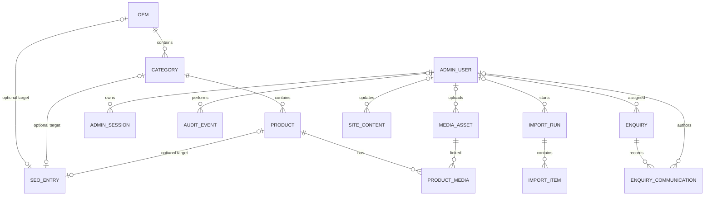

# PostgreSQL Data Dictionary

This reference describes the Prisma data model in
[`backend/prisma/schema.prisma`](../backend/prisma/schema.prisma) and the SQL
migrations in `backend/prisma/migrations/`. It documents the source-controlled
schema; it does not assert that a client production database has these migrations
applied. Confirm the target database and migration state before operating on it.

## Conventions and verification basis

- Prisma `String` maps to PostgreSQL `TEXT` unless a native type is specified;
  `Int` to `INTEGER`; `Boolean` to `BOOLEAN`; `DateTime` to `TIMESTAMP(3)`;
  `Json` to `JSONB`; and `BigInt` to `BIGINT`.
- `String?`, `Int?`, `DateTime?`, and `Json?` are nullable. Fields without `?`
  are required. `@db.Char(64)` is PostgreSQL `CHAR(64)`.
- `@default(cuid())` is generated by Prisma Client; the SQL column is `TEXT`
  without a PostgreSQL-side CUID default. `@updatedAt` is maintained by Prisma
  Client; the corresponding `updatedAt` SQL column is required and has no SQL
  default unless a migration explicitly says otherwise.
- PK = primary key; FK = foreign key; UQ = unique constraint/index. Index names
  below use the migration-defined SQL names where applicable. Partial indexes
  and checks are called out separately.
- This document was checked against all five checked-in migrations listed below.
  Migration history, not manual edits to this document, is authoritative for
  database changes.

## Entity relationship diagram

`CmsDocument`, `CareerApplication`, and `ConnectionTest` have no Prisma
relationships. `SeoEntry` has zero or one catalogue target (OEM, category, or
product); a site-wide SEO row may have no target.

## Enumerations

| Enum | Values |
|---|---|
| `MediaAssetStatus` | `PENDING`, `ACTIVE`, `RETIRED`, `FAILED` |
| `EnquiryStatus` | `RECEIVED`, `EMAILED`, `EMAIL_FAILED` |
| `EnquiryRegion` | `INDIA`, `SINGAPORE`, `USA` |
| `EnquiryWorkflowStatus` | `NEW`, `ASSIGNED`, `IN_PROGRESS`, `QUOTED`, `CONTACTED`, `CLOSED`, `ARCHIVED` |
| `CommunicationType` | `INTERNAL_NOTE`, `EMAIL_OUTBOUND`, `CUSTOMER_REPLY`, `PHONE_LOG`, `STATUS_CHANGE` |
| `AdminRole` | `ADMIN`, `EDITOR` |
| `ImportRunType` | `BASELINE_CMS`, `EXCEL_RECONCILIATION` |
| `ImportRunStatus` | `PREVIEWED`, `APPLYING`, `APPLIED`, `FAILED`, `ROLLED_BACK` |
| `ImportClassification` | `BASELINE_RECORD`, `CONFIRMED_MATCH`, `POSSIBLE_MATCH`, `NEW_CANDIDATE`, `CONFLICT`, `NEEDS_MANUAL_REVIEW` |
| `ImportDecisionStatus` | `PENDING`, `APPROVED`, `REJECTED`, `APPLIED`, `FAILED` |

**Count correction:** the current Prisma schema defines **10 enums**, not nine.
This list reflects the schema rather than the earlier estimate in the Phase 5
plan.

## Models and fields

### Catalogue

#### `Oem`

| Field | Prisma type | Nullability/default/constraint |
|---|---|---|
| `id` | `String` | PK; required; caller-supplied ID |
| `name` | `String` | Required |
| `websiteUrl` | `String?` | Nullable |
| `visible` | `Boolean` | Required; default `true` |
| `sortOrder` | `Int` | Required; default `0` |
| `sourceData` | `Json?` | Nullable |
| `version` | `Int` | Required; default `1` |
| `createdAt` | `DateTime` | Required; default `now()` |
| `updatedAt` | `DateTime` | Required; Prisma `@updatedAt` |

Relationships: one OEM has many Categories and zero or one SeoEntry target row.
The Category foreign key uses `ON DELETE RESTRICT ON UPDATE CASCADE`.

#### `Category`

| Field | Prisma type | Nullability/default/constraint |
|---|---|---|
| `id` | `String` | PK; required; caller-supplied ID |
| `oemId` | `String` | Required FK to `Oem.id` |
| `name` | `String` | Required |
| `visible` | `Boolean` | Required; default `true` |
| `sortOrder` | `Int` | Required; default `0` |
| `sourceData` | `Json?` | Nullable |
| `version` | `Int` | Required; default `1` |
| `createdAt` | `DateTime` | Required; default `now()` |
| `updatedAt` | `DateTime` | Required; Prisma `@updatedAt` |

Relationships: belongs to one OEM; has many Products and zero or one SeoEntry
target row.
`Category.oemId` deletion is restricted; updates cascade.

#### `Product`

| Field | Prisma type | Nullability/default/constraint |
|---|---|---|
| `id` | `String` | PK; required; caller-supplied ID |
| `categoryId` | `String` | Required FK to `Category.id` |
| `name` | `String` | Required |
| `description` | `String?` | Nullable |
| `applications` | `String?` | Nullable |
| `externalLink` | `String?` | Nullable |
| `visible` | `Boolean` | Required; default `true` |
| `sortOrder` | `Int` | Required; default `0` |
| `sourceImagePath` | `String?` | Nullable |
| `sourceData` | `Json?` | Nullable |
| `version` | `Int` | Required; default `1` |
| `createdAt` | `DateTime` | Required; default `now()` |
| `updatedAt` | `DateTime` | Required; Prisma `@updatedAt` |

Relationships: belongs to one category; has many ProductMedia rows and zero or
one SeoEntry target row.
`Product.categoryId` deletion is restricted; updates cascade.

### SEO and media

#### `SeoEntry`

| Field | Prisma type | Nullability/default/constraint |
|---|---|---|
| `id` | `String` | PK; required; Prisma-generated CUID |
| `routeKey` | `String` | Required; UQ |
| `oemId` | `String?` | Nullable; UQ FK to `Oem.id` |
| `categoryId` | `String?` | Nullable; UQ FK to `Category.id` |
| `productId` | `String?` | Nullable; UQ FK to `Product.id` |
| `title` | `String?` | Nullable |
| `description` | `String?` | Nullable |
| `canonicalUrl` | `String?` | Nullable |
| `socialMetadata` | `Json?` | Nullable |
| `structuredData` | `Json?` | Nullable |
| `sourceData` | `Json?` | Nullable |
| `version` | `Int` | Required; default `1` |
| `createdAt` | `DateTime` | Required; default `now()` |
| `updatedAt` | `DateTime` | Required; Prisma `@updatedAt` |

Each optional target FK uses `ON DELETE RESTRICT ON UPDATE CASCADE`. Migration
`20261019233400_add_cms_backend_schema` adds a check allowing at most one of
`oemId`, `categoryId`, and `productId` to be non-null; all three null represents
site-wide SEO. Each target has a unique index, so each target may have at most
one SEO row.

#### `MediaAsset`

| Field | Prisma type | Nullability/default/constraint |
|---|---|---|
| `id` | `String` | PK; required; Prisma-generated CUID |
| `sourcePath` | `String?` | Nullable |
| `r2Key` | `String?` | Nullable; UQ |
| `publicUrl` | `String?` | Nullable |
| `mimeType` | `String?` | Nullable |
| `byteSize` | `BigInt?` | Nullable |
| `sha256` | `String?` | Nullable; PostgreSQL `CHAR(64)` |
| `status` | `MediaAssetStatus` | Required; default `PENDING` |
| `uploadedById` | `String?` | Nullable FK to `AdminUser.id` |
| `createdAt` | `DateTime` | Required; default `now()` |
| `updatedAt` | `DateTime` | Required; Prisma `@updatedAt` |

Uploader deletion sets `uploadedById` null; updates cascade. The model also has
ProductMedia links.

#### `ProductMedia`

| Field | Prisma type | Nullability/default/constraint |
|---|---|---|
| `productId` | `String` | Required FK; part of composite PK |
| `mediaAssetId` | `String` | Required FK; part of composite PK |
| `sortOrder` | `Int` | Required; default `0` |
| `altText` | `String?` | Nullable |
| `isPrimary` | `Boolean` | Required; default `false` |
| `createdAt` | `DateTime` | Required; default `now()` |

Composite PK: (`productId`, `mediaAssetId`). Product deletion cascades; media
asset deletion is restricted; updates cascade. A migration-created partial
unique index permits at most one `isPrimary = TRUE` row per product.

### Enquiries and careers

#### `Enquiry`

| Field | Prisma type | Nullability/default/constraint |
|---|---|---|
| `id` | `String` | PK; required; Prisma-generated CUID |
| `type` | `String` | Required |
| `fullname` | `String` | Required |
| `company` | `String` | Required |
| `email` | `String` | Required |
| `phone` | `String` | Required |
| `model` | `String?` | Nullable |
| `message` | `String` | Required |
| `status` | `EnquiryStatus` | Required; default `RECEIVED` |
| `emailError` | `String?` | Nullable |
| `region` | `EnquiryRegion?` | Nullable; legacy/unclassified records may be null |
| `workflowStatus` | `EnquiryWorkflowStatus` | Required; default `NEW` |
| `assignedToId` | `String?` | Nullable FK to `AdminUser.id` |
| `ip` | `String?` | Nullable; abuse investigation field |
| `createdAt` | `DateTime` | Required; default `now()` |
| `updatedAt` | `DateTime` | Required; Prisma `@updatedAt` |

Assignee deletion sets `assignedToId` null; updates cascade. Has many
EnquiryCommunication rows; deleting an enquiry is restricted while communications
exist.

#### `EnquiryCommunication`

| Field | Prisma type | Nullability/default/constraint |
|---|---|---|
| `id` | `String` | PK; required; Prisma-generated CUID |
| `enquiryId` | `String` | Required FK to `Enquiry.id` |
| `type` | `CommunicationType` | Required |
| `subject` | `String?` | Nullable |
| `body` | `String` | Required |
| `metadata` | `Json?` | Nullable |
| `authorId` | `String?` | Nullable FK to `AdminUser.id` |
| `createdAt` | `DateTime` | Required; default `now()` |
| `updatedAt` | `DateTime` | Required; Prisma `@updatedAt` |

Enquiry deletion is restricted; author deletion sets `authorId` null; FK updates
cascade.

#### `CareerApplication`

| Field | Prisma type | Nullability/default/constraint |
|---|---|---|
| `id` | `String` | PK; required; Prisma-generated CUID |
| `fullname` | `String` | Required |
| `email` | `String` | Required |
| `position` | `String` | Required |
| `phone` | `String` | Required |
| `city` | `String` | Required |
| `experience` | `String` | Required |
| `organization` | `String` | Required |
| `notice` | `String` | Required |
| `skills` | `String` | Required |
| `linkedin` | `String?` | Nullable |
| `statement` | `String` | Required |
| `resumeName` | `String?` | Nullable; original filename only |
| `resumeSizeKb` | `Int?` | Nullable |
| `status` | `EnquiryStatus` | Required; default `RECEIVED` |
| `emailError` | `String?` | Nullable |
| `ip` | `String?` | Nullable |
| `createdAt` | `DateTime` | Required; default `now()` |
| `updatedAt` | `DateTime` | Required; Prisma `@updatedAt` |

The resume binary is not stored in this table.

### Administration, auditing, and imports

#### `AdminUser`

| Field | Prisma type | Nullability/default/constraint |
|---|---|---|
| `id` | `String` | PK; required; Prisma-generated CUID |
| `email` | `String` | Required; UQ |
| `passwordHash` | `String` | Required; password hash, never plaintext |
| `role` | `AdminRole` | Required; default `EDITOR` |
| `active` | `Boolean` | Required; default `true` |
| `passwordChangedAt` | `DateTime?` | Nullable |
| `createdAt` | `DateTime` | Required; default `now()` |
| `updatedAt` | `DateTime` | Required; Prisma `@updatedAt` |

Parent of sessions and optional relationships to media uploads, audit events,
import runs, site content updates, assigned enquiries, and authored communications.

#### `AdminSession`

| Field | Prisma type | Nullability/default/constraint |
|---|---|---|
| `id` | `String` | PK; required; Prisma-generated CUID |
| `adminUserId` | `String` | Required FK to `AdminUser.id` |
| `tokenHash` | `String` | Required; UQ; PostgreSQL `CHAR(64)` |
| `csrfTokenHash` | `String` | Required; PostgreSQL `CHAR(64)` |
| `absoluteExpiresAt` | `DateTime` | Required |
| `lastSeenAt` | `DateTime` | Required; default `now()` |
| `revokedAt` | `DateTime?` | Nullable |
| `createdAt` | `DateTime` | Required; default `now()` |
| `updatedAt` | `DateTime` | Required; Prisma `@updatedAt` |

User deletion cascades to sessions; updates cascade. Only token hashes are stored.

#### `AuditEvent`

| Field | Prisma type | Nullability/default/constraint |
|---|---|---|
| `id` | `String` | PK; required; Prisma-generated CUID |
| `adminUserId` | `String?` | Nullable FK to `AdminUser.id` |
| `action` | `String` | Required |
| `entityType` | `String` | Required |
| `entityId` | `String?` | Nullable |
| `requestId` | `String?` | Nullable |
| `beforeData` | `Json?` | Nullable |
| `afterData` | `Json?` | Nullable |
| `createdAt` | `DateTime` | Required; default `now()` |

User deletion sets `adminUserId` null; updates cascade.

#### `ImportRun`

| Field | Prisma type | Nullability/default/constraint |
|---|---|---|
| `id` | `String` | PK; required; Prisma-generated CUID |
| `type` | `ImportRunType` | Required |
| `status` | `ImportRunStatus` | Required; default `PREVIEWED` |
| `sourceFingerprint` | `String` | Required |
| `startedById` | `String?` | Nullable FK to `AdminUser.id` |
| `summary` | `Json?` | Nullable |
| `createdAt` | `DateTime` | Required; default `now()` |
| `updatedAt` | `DateTime` | Required; Prisma `@updatedAt` |

Started-by user deletion sets `startedById` null; updates cascade. Has many
ImportItem rows.

#### `ImportItem`

| Field | Prisma type | Nullability/default/constraint |
|---|---|---|
| `id` | `String` | PK; required; Prisma-generated CUID |
| `importRunId` | `String` | Required FK to `ImportRun.id` |
| `sourceKey` | `String` | Required |
| `sourceRow` | `Int?` | Nullable |
| `cmsEntityType` | `String?` | Nullable |
| `cmsEntityId` | `String?` | Nullable |
| `classification` | `ImportClassification` | Required |
| `decisionStatus` | `ImportDecisionStatus` | Required; default `PENDING` |
| `currentData` | `Json?` | Nullable |
| `proposedData` | `Json?` | Nullable |
| `error` | `String?` | Nullable |
| `createdAt` | `DateTime` | Required; default `now()` |
| `updatedAt` | `DateTime` | Required; Prisma `@updatedAt` |

Unique constraint: (`importRunId`, `sourceKey`). ImportRun deletion cascades;
updates cascade.

### CMS and technical

#### `SiteContent`

| Field | Prisma type | Nullability/default/constraint |
|---|---|---|
| `id` | `String` | PK; required; Prisma-generated CUID |
| `pageKey` | `String` | Required; UQ |
| `content` | `Json` | Required |
| `createdAt` | `DateTime` | Required; default `now()` |
| `updatedAt` | `DateTime` | Required; Prisma `@updatedAt` |
| `updatedById` | `String?` | Nullable FK to `AdminUser.id` |

User deletion sets `updatedById` null; updates cascade.

#### `CmsDocument`

| Field | Prisma type | Nullability/default/constraint |
|---|---|---|
| `key` | `String` | PK; required |
| `data` | `Json` | Required |
| `version` | `Int` | Required; default `1` |
| `createdAt` | `DateTime` | Required; default `now()` |
| `updatedAt` | `DateTime` | Required; Prisma `@updatedAt` |

This model remains in the schema and initial CMS migration. Its removal is not
part of this handover; evaluate runtime/database dependencies and migration
history separately before any future removal.

#### `ConnectionTest`

| Field | Prisma type | Nullability/default/constraint |
|---|---|---|
| `id` | `Int` | PK; required; auto-increment |
| `message` | `String` | Required |
| `createdAt` | `DateTime` | Required; default `now()` |

## Indexes and database constraints

The migrations define these indexes and additional constraints:

| Model | Index/constraint |
|---|---|
| `Oem` | Index (`visible`, `sortOrder`, `id`) |
| `Category` | Index (`oemId`, `visible`, `sortOrder`, `id`) |
| `Product` | Index (`categoryId`, `visible`, `sortOrder`, `id`); index (`visible`, `sortOrder`, `id`) |
| `SeoEntry` | UQ `routeKey`, `oemId`, `categoryId`, `productId`; check `num_nonnulls(oemId, categoryId, productId) <= 1` |
| `MediaAsset` | UQ `r2Key`; index (`status`, `sha256`) |
| `ProductMedia` | Composite PK (`productId`, `mediaAssetId`); index (`productId`, `sortOrder`); index (`mediaAssetId`); partial unique index on `productId` where `isPrimary = TRUE` |
| `AdminUser` | UQ `email` |
| `AdminSession` | UQ `tokenHash`; indexes (`adminUserId`, `absoluteExpiresAt`), (`absoluteExpiresAt`), (`lastSeenAt`) |
| `AuditEvent` | Indexes (`entityType`, `entityId`, `createdAt`), (`adminUserId`, `createdAt`) |
| `ImportRun` | Index (`type`, `status`, `createdAt`) |
| `ImportItem` | UQ (`importRunId`, `sourceKey`); indexes (`importRunId`, `decisionStatus`), (`cmsEntityType`, `cmsEntityId`) |
| `SiteContent` | UQ `pageKey`; index `pageKey` |
| `Enquiry` | Indexes (`status`, `createdAt`), (`workflowStatus`, `region`, `createdAt`), (`assignedToId`, `workflowStatus`) |
| `EnquiryCommunication` | Indexes (`enquiryId`, `createdAt`), (`type`, `createdAt`), (`authorId`, `createdAt`) |
| `CareerApplication` | Index (`status`, `createdAt`) |
| `ConnectionTest`, `CmsDocument` | Primary key only in the checked-in migrations |

Foreign-key delete/update behavior is described per model above and is defined
in the relevant migration SQL.

## Migration history checked

| Migration directory | Schema contribution |
|---|---|
| `20261017100248_init` | Creates `ConnectionTest`. |
| `20261019233400_add_cms_backend_schema` | Adds catalogue, SEO, media, admin/session/audit, import-run/item models and their enums, indexes, FKs, SEO target check, and partial primary-media unique index. Creates `CmsDocument`. |
| `20261028111359_add_enquiry_models` | Adds `EnquiryStatus`, `Enquiry`, `CareerApplication`, and their status/created indexes. |
| `20261105000000_add_site_content_model` | Adds `SiteContent`, unique/indexed `pageKey`, and optional updater FK. |
| `20261106000000_add_enquiry_workflow_and_communications` | Adds region/workflow/communication enums and fields, `EnquiryCommunication`, indexes, and its/assignee FKs. |

Apply migrations through the backend package with `npm run migrate` only after
the client confirms the target, authorizes the operation, and verifies a backup.
Do not edit applied migration files to recover from an error.
